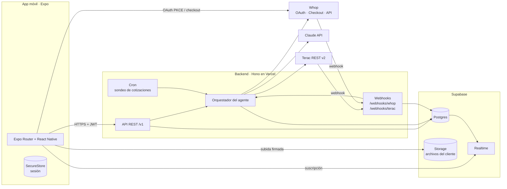
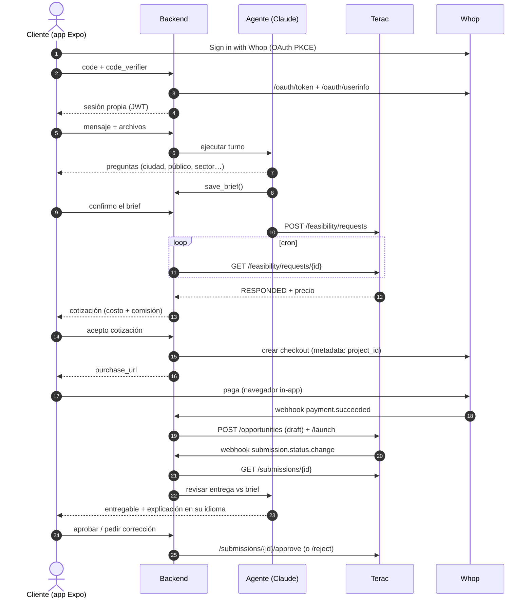
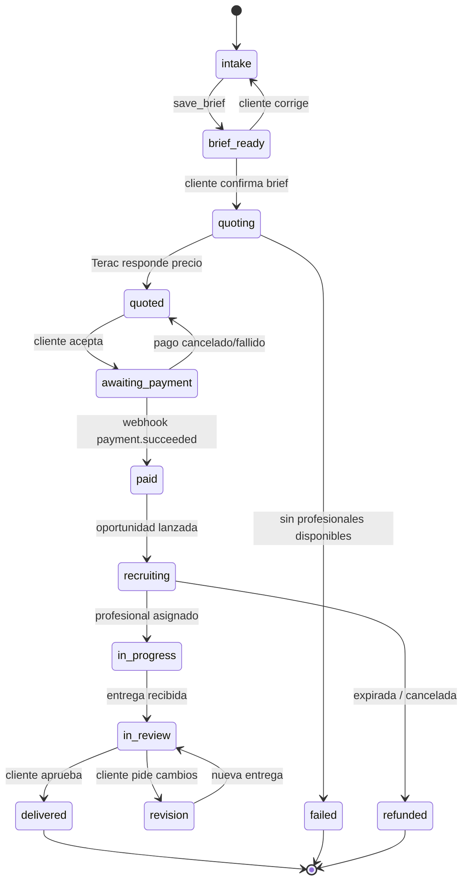

# 02 · Arquitectura del sistema

## Vista general



## Componentes

| Componente | Tecnología | Responsabilidad |
|------------|------------|-----------------|
| **App móvil** | Expo (SDK estable más reciente), Expo Router, TypeScript | UI, chat, subida de archivos, login, abrir checkout, recibir notificaciones push. **No guarda secretos.** |
| **API** | Hono (TypeScript) desplegado en Vercel | Autenticación propia, CRUD de proyectos, emitir URLs firmadas, crear checkouts, decisiones del cliente. |
| **Orquestador del agente** | Módulo del backend + Claude API (tool use) | Conversa, arma el brief, pide cotizaciones, lanza trabajos en Terac, revisa entregas. Se ejecuta por **evento**. |
| **Webhooks** | Rutas del backend | Recibir `payment.succeeded` de Whop y `submission.*` de Terac, verificar firma, deduplicar y despertar al agente. |
| **Cron** | Vercel Cron (cada 1–2 min) | Sondear cotizaciones de Terac pendientes (`GET /feasibility/requests/{id}`). |
| **Base de datos** | Supabase Postgres + Drizzle ORM | Usuarios, proyectos, mensajes, cotizaciones, pagos, entregas, eventos. |
| **Archivos** | Supabase Storage | Campañas y materiales del cliente; entregables copiados desde Terac. |
| **Tiempo real** | Supabase Realtime | La app escucha cambios en `messages` y `projects` para no hacer polling. |
| **IA** | Claude (`claude-sonnet-5-5` para el chat; `claude-opus-5-5` para revisar entregas) | Razonamiento, multilingüe, uso de herramientas. |
| **Profesionales** | Terac REST v2 | Cotizar, crear y lanzar oportunidades, gestionar entregas. |
| **Identidad y pagos** | Whop | Sign in with Whop, checkout alojado, webhooks de pago, reembolsos. |

### ¿Por qué un backend separado y no solo Expo API Routes?

Expo Router permite rutas `+api.ts`, pero aquí necesitamos webhooks firmados, un cron, ejecuciones del agente que pueden durar decenas de segundos y claves de dos proveedores de pago/trabajo. Un servicio Hono en Vercel cubre todo eso, se despliega con un `git push` y se puede probar con `vercel dev`. Si el equipo prefiere un solo despliegue, las mismas rutas se pueden mover a Expo API Routes en EAS Hosting más adelante.

## Flujo extremo a extremo



## Máquina de estados del proyecto

El estado vive en `projects.status` y **solo el servidor** lo cambia. El agente pide transiciones mediante herramientas; el servidor las valida.



## Principios de diseño

1. **El dinero lo controla el servidor, no el modelo.** `create_opportunity` y `launch_opportunity` fallan si no hay un pago `succeeded` para ese proyecto, aunque el agente las llame.
2. **Todo por eventos.** Un turno del agente se dispara por: mensaje del cliente, cotización lista, pago confirmado, entrega recibida. Así no hay procesos larguísimos vivos.
3. **Idempotencia.** Cada webhook se guarda en `webhook_events` con clave única `(provider, event_id)`. Terac manda `X-Event-ID` estable entre reintentos. Antes de reintentar un `POST` a Terac, se lista para comprobar que no se creó ya.
4. **Sin suposiciones de idioma.** `source_language` y `target_language` son códigos BCP-47 libres (`es`, `en-US`, `pt-BR`, `ko`…). La UI se traduce con i18n.
5. **Trazabilidad.** Cada turno del agente guarda en `agent_runs` qué herramientas llamó, con qué argumentos y qué devolvieron.

## Seguridad

- **Secretos** (`TERAC_API_KEY`, `WHOP_API_KEY`, `WHOP_WEBHOOK_SECRET`, `TERAC_WEBHOOK_SECRET`, `ANTHROPIC_API_KEY`, `SUPABASE_SERVICE_ROLE_KEY`) solo en variables de entorno del backend.
- **Sesión**: JWT propio firmado por el backend, guardado en `expo-secure-store`. Tokens de Whop guardados cifrados en el servidor si hacen falta.
- **Webhooks**: verificación HMAC (Terac: `X-Terac-Request-Signature` sobre `timestamp + raw body`, rechazar si > 300 s). Whop: verificar con el secreto del webhook según su documentación.
- **Archivos**: buckets privados; subida y descarga solo con URLs firmadas de vida corta.
- **Supabase RLS** activado: cada usuario solo lee sus proyectos y mensajes (para Realtime).
- **Datos personales**: los datos de los profesionales de Terac (email, LinkedIn) no se muestran al cliente; solo nombre y resumen de experiencia.

## Entornos

| Entorno | App | Backend | Terac | Whop |
|---------|-----|---------|-------|------|
| `dev` | Expo Go / dev build | `vercel dev` + túnel para webhooks | org de pruebas | **sandbox** |
| `demo` | EAS build interna | Vercel Preview | org real con presupuesto limitado | sandbox (o producción con importe mínimo) |
| `prod` | App Store / Play | Vercel Production | org real | producción |

## Estructura del repositorio

```
bilingualcheck/
├─ apps/
│  ├─ mobile/            # Expo (Expo Router)
│  └─ api/               # Hono en Vercel
├─ packages/
│  └─ shared/            # Tipos, esquemas zod, estados, códigos de idioma
├─ docs/                 # Estos documentos
├─ pnpm-workspace.yaml
└─ package.json
```
