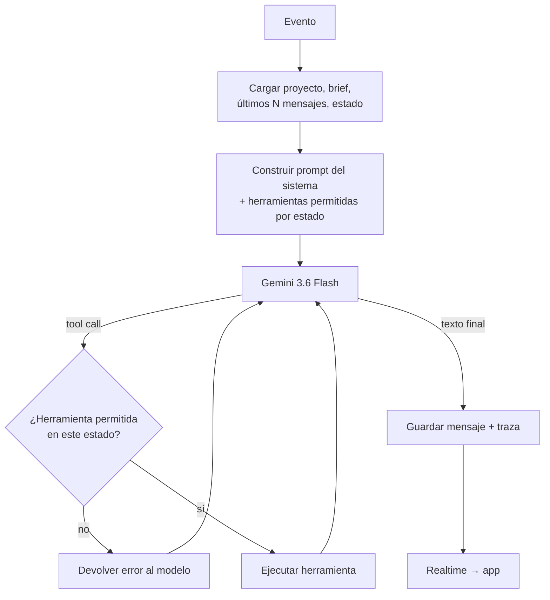

# 03 · Agente de IA

Estado de implementación (2026-10-24): la revisión de la entrega se ejecuta en `services/submissions.ts`, fuera de la elección libre de herramientas del agente. Solo llama a `agent/review.ts` con contenido recibido, verifica la versión y publica la tarjeta en una transacción. La decisión de pago sigue siendo del cliente. Ver [doc 10](10-entregas-y-validacion.md).

## Rol

El agente es un **project manager multilingüe**: entiende al negocio, traduce su necesidad en un brief accionable para un profesional, contrata vía Terac, revisa lo que llega y lo explica al cliente en su idioma. **No hace el trabajo cultural él mismo**: lo hacen las personas contratadas.

## Modelo de ejecución

El agente no es un proceso que vive para siempre. Cada **evento** lanza un *turno*:

| Evento | Quién lo dispara | Qué hace el agente |
|--------|------------------|--------------------|
| `user_message` | `POST /v1/projects/:id/messages` | Seguir la entrevista, actualizar el brief, responder dudas. |
| `brief_confirmed` | El cliente pulsa "Confirmar brief" | Pedir cotización a Terac. |
| `quote_ready` | Cron que sondea Terac | Presentar la cotización al cliente. |
| `payment_succeeded` | Webhook de Whop | Crear y lanzar la oportunidad en Terac; avisar al cliente. |
| `submission_received` | Webhook de Terac | Revisar la entrega frente al brief y presentarla. |
| `client_decision` | El cliente aprueba / pide cambios | Aprobar en Terac o preparar la corrección. |

Un turno = cargar contexto → llamar a Gemini con herramientas → ejecutar herramientas en bucle → guardar mensajes, estado y traza en `agent_runs`.



## Modelos

- **Chat y orquestación**: `gemini-3.6-flash`, configurable con `AGENT_MODEL`.
- **Revisión de entregas**: `gemini-3.6-flash`, configurable con `REVIEW_MODEL`, salida estructurada validada por Zod.
- Límite de iteraciones por turno: 8 llamadas a herramientas. Si se supera, el turno termina y se avisa al operador.

El backend usa `ai` + `@ai-sdk/google` y `GEMINI_API_KEY`, sin claves en el cliente. Razonamiento `low`, máximo de 16 000 tokens de salida por llamada, un reintento ante errores transitorios y 90 segundos de timeout por llamada. El historial del bucle conserva las firmas de Gemini junto con las llamadas y sus resultados.

## Herramientas (tool use)

Las herramientas se ofrecen **según el estado** del proyecto. El servidor vuelve a validar cada llamada.

| Herramienta | Estados donde está disponible | Efecto |
|-------------|-------------------------------|--------|
| `ask_client` | todos | Mensaje al cliente con preguntas (opcionalmente con opciones rápidas). |
| `save_brief` | `intake`, `brief_ready` | Guarda/actualiza el brief estructurado y pasa a `brief_ready`. |
| `request_quote` | `brief_ready` (tras confirmación) | `POST /feasibility/requests` en Terac → `quoting`. |
| `present_quote` | `quoted` | Calcula precio final (costo + comisión) y muestra la tarjeta de cotización. |
| `create_opportunity` | `paid` | `POST /opportunities` (borrador) a partir del brief. **Exige pago confirmado.** |
| `launch_opportunity` | `paid` | `POST /opportunities/{id}/launch` → `recruiting`. **Exige pago confirmado.** |
| `get_submission` | `in_progress`, `in_review`, `revision` | `GET /submissions/{id}` + archivos. |
| `review_submission` | `in_review` | Guarda la evaluación estructurada (cumple / no cumple / notas). |
| `approve_submission` | `in_review` tras aprobación del cliente | `POST /submissions/{id}/approve` → `delivered`. |
| `request_revision` | `in_review` tras petición del cliente | Prepara la corrección (ver doc 04). |
| `recommend_followup` | `delivered` | Sugiere otro trabajo (p. ej. desarrollador web). Solo sugerencia. |

### Esquema del brief (`save_brief`)

```ts
type Brief = {
  business: { name: string; sector: string; offer: string; website?: string };
  goal: string;                       // "atraer clientes angloparlantes a la clínica"
  source_language: string;            // BCP-47, p. ej. "es"
  target_language: string;            // BCP-47, p. ej. "en-US"
  target_market: { city?: string; region?: string; country: string };
  audience: string;                   // edad, intereses, comunidad
  cultural_notes: string[];           // jerga, referencias, cosas a evitar
  deliverable_type: "campaign_adaptation" | "web_copy" | "web_dev" | "design" | "other";
  deliverables: string[];             // "3 anuncios para Instagram", "landing en inglés"
  acceptance_criteria: string[];      // cómo sabremos que está bien
  asset_ids: string[];                // archivos subidos por el cliente
  deadline_days?: number;
  budget_usd?: number;
  professional_profile: string;       // "especialista en marketing para el mercado hispano/anglo de Miami"
};
```

## Prompt del sistema (borrador)

```
Eres BilingualCheck, un agente que ayuda a negocios a llegar a comunidades que hablan otro idioma.

Responde SIEMPRE en el idioma del cliente ({client_language}), con tono claro, cercano e inclusivo.

Tu trabajo:
1. Entender la meta del negocio, el mercado (ciudad, región, país), el público y el sector.
2. Hacer pocas preguntas y concretas; no más de 3 por mensaje.
3. Construir un brief con save_brief y pedir al cliente que lo confirme.
4. Contratar profesionales reales mediante Terac; tú no haces el trabajo cultural.
5. Revisar las entregas frente al brief y explicar en el idioma del cliente qué se adaptó y por qué.

Reglas:
- No reduzcas el trabajo a "traducir". Habla de adaptación cultural y comercial.
- No asumas que los idiomas son inglés y español.
- No prometas ventas ni resultados garantizados.
- No uses estereotipos culturales.
- No muestres datos de contacto de los profesionales.
- Nunca digas que algo está pagado o contratado si una herramienta no lo confirmó.

Estado actual del proyecto: {status}
Brief actual: {brief_json}
```

## Revisión de entregas

Prompt de revisión (Gemini), con salida estructurada:

```ts
type SubmissionReview = {
  meets_brief: boolean;
  criteria: { criterion: string; met: boolean; note: string }[];
  cultural_changes_explained: string;   // en el idioma del cliente
  issues: string[];
  suggested_revision_request?: string;  // en el idioma del profesional
};
```

La IA **recomienda**; la decisión de aprobar es del cliente. Si `meets_brief = false`, la app lo muestra claramente y propone pedir una corrección con el texto sugerido.

## Guardarraíles

- **Validación por estado** de cada herramienta en el servidor (ver doc 02).
- **Presupuesto**: `request_quote` y `create_opportunity` fallan si el precio supera `budget_usd` del brief (si existe) o un tope global de la demo.
- **Idempotencia** en herramientas con efectos: clave `(project_id, tool, hash(args))`.
- **Moderación**: rechazar proyectos de contenido ilegal, engañoso o que pida suplantar a otra marca.
- **Contenido de entregas como datos**: el texto de un entregable nunca se trata como instrucciones para el agente.

## Alternativa: Terac por MCP

Terac ofrece un servidor MCP (`https://terac.com/api/mcp`) con herramientas como `terac_request_feasibility`, `terac_get_feasibility_request`, `terac_launch_draft_opportunity` y `terac_get_submissions`. Es útil para **prototipar** el agente en Claude Code/Desktop antes de escribir el backend. En producción preferimos la **REST API con API key**, porque el MCP usa OAuth interactivo y queremos que el servidor valide cada paso con dinero.
