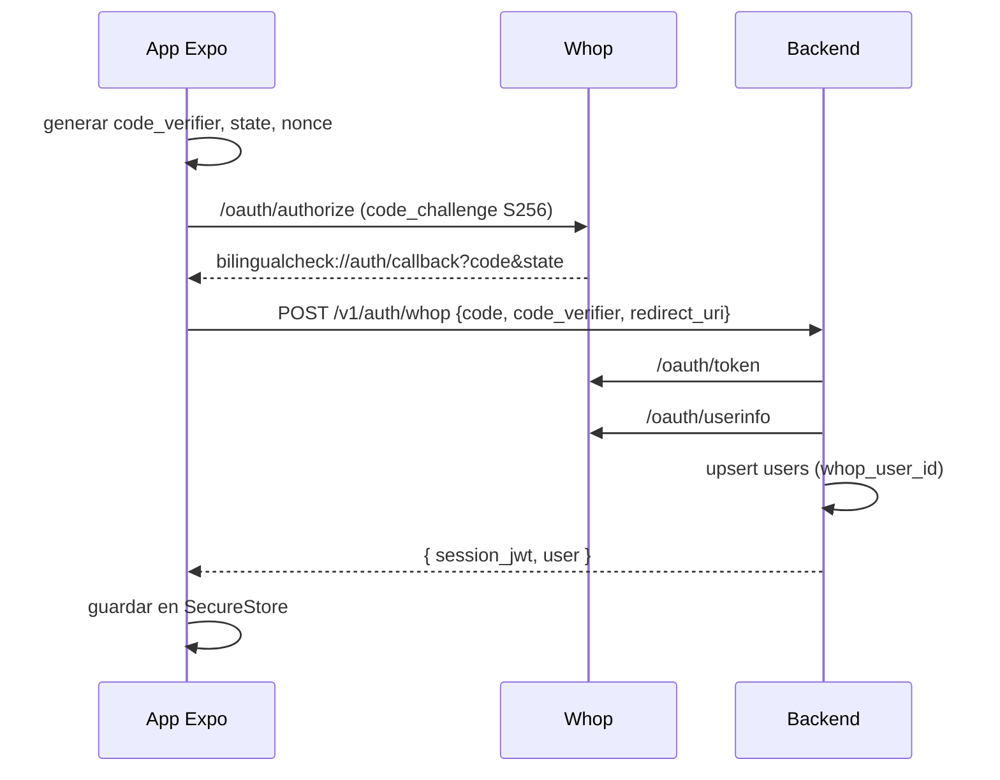

# 05 · Integración con Whop

Usamos Whop para **identidad** (Sign in with Whop) y **cobro** (checkout alojado + webhooks). Whop no paga a los profesionales: de eso se encarga Terac, que factura a nuestra organización.

> Nota: el paquete `@whop/react-native` sirve para construir apps que **se ejecutan dentro de Whop**, no apps Expo independientes. Para nuestra app usamos OAuth estándar y el checkout web, que funcionan con cualquier app Expo. Los puntos marcados con **[verificar]** hay que confirmarlos en la referencia de la API.

## Configuración en el panel de Whop

1. Crear la **app** en el Developer Dashboard → obtener `client_id` (y secreto si aplica).
2. Registrar **redirect URIs** exactas:
   - `bilingualcheck://auth/callback` (app nativa)
   - `https://<api>/auth/whop/callback` (web / respaldo)
3. Crear un **producto** "Proyecto BilingualCheck" → `WHOP_PRODUCT_ID`. Anotar `WHOP_ACCOUNT_ID` (`biz_…`).
4. Crear un **webhook** hacia `https://<api>/webhooks/whop` con `payment.succeeded` (y eventos de pago fallido/reembolso) → `WHOP_WEBHOOK_SECRET`.
5. Trabajar en **sandbox** hasta la demo.

## 1. Sign in with Whop (OAuth 2.1 + PKCE)

| Endpoint | URL |
|----------|-----|
| Autorizar | `https://api.whop.com/oauth/authorize` |
| Token | `https://api.whop.com/oauth/token` |
| Userinfo | `https://api.whop.com/oauth/userinfo` |
| Revocar | `https://api.whop.com/oauth/revoke` |

Scopes: `openid profile email`. El access token dura 1 hora; los refresh tokens **rotan** en cada uso.



En Expo, con `expo-auth-session`:

```ts
const discovery = {
  authorizationEndpoint: "https://api.whop.com/oauth/authorize",
  tokenEndpoint: "https://api.whop.com/oauth/token",
};
const redirectUri = AuthSession.makeRedirectUri({ scheme: "bilingualcheck", path: "auth/callback" });

const [request, response, promptAsync] = AuthSession.useAuthRequest(
  {
    clientId: WHOP_CLIENT_ID,
    redirectUri,
    scopes: ["openid", "profile", "email"],
    usePKCE: true,              // S256
    extraParams: { nonce },
  },
  discovery,
);

// Cuando response.type === "success":
await api.post("/v1/auth/whop", {
  code: response.params.code,
  code_verifier: request!.codeVerifier,
  redirect_uri: redirectUri,
});
```

El intercambio del código se hace **en el backend** para no exponer secretos y para emitir nuestra propia sesión.

## 2. Cobrar un proyecto

Cada proyecto tiene un precio distinto (cotización de Terac + comisión), así que creamos un checkout **por proyecto**.

```ts
import { WhopClient } from "@whop/sdk";   // SDK TypeScript oficial (backend)
const whop = new WhopClient({ apiKey: process.env.WHOP_API_KEY });

const variant = await whop.variants.create({
  account_id: process.env.WHOP_ACCOUNT_ID,   // biz_...
  product_id: process.env.WHOP_PRODUCT_ID,   // prod_...
  initial_price: quote.total_usd,            // p. ej. 109.20
  plan_type: "one_time",
  // metadata: { project_id }                 [verificar: dónde se adjunta metadata para que vuelva en el webhook]
});
return { purchase_url: variant.purchase_url };
```

- La metadata que se adjunta al pago vuelve en el webhook; la usamos para mapear `project_id`. Si `variants.create` no admite metadata, usar la API de **checkout configurations** o guardar el `variant.id` en `payments` y mapear por él **[verificar]**.
- Guardamos `payments(status = 'pending', whop_variant_id, amount)` antes de devolver la URL.

### Abrir el checkout en Expo

```ts
import * as WebBrowser from "expo-web-browser";

const returnUrl = Linking.createURL("checkout/return");   // bilingualcheck://checkout/return
const result = await WebBrowser.openAuthSessionAsync(purchaseUrl, returnUrl);
// Whop añade ?payment=...&status=succeeded|failed|canceled a la URL de retorno.
// La app SOLO muestra "procesando"; la verdad la decide el webhook.
```

Si el checkout alojado no permite configurar `returnUrl` para este flujo, la app vuelve con el botón de cerrar y espera el cambio de estado por Realtime **[verificar]**.

### Webhook `payment.succeeded`

```
POST /webhooks/whop
 1. Verificar la firma con WHOP_WEBHOOK_SECRET (según la guía de webhooks de Whop).
 2. Deduplicar por id de evento en webhook_events.
 3. Buscar el payment por metadata.project_id (o variant_id).
 4. Comprobar que el importe coincide con la cotización.
 5. payments.status = 'succeeded'; projects.status = 'paid'.
 6. Encolar evento payment_succeeded → el agente crea y lanza la oportunidad en Terac.
 7. Responder 200 rápido.
```

**Nunca** se lanza nada en Terac desde la URL de retorno de la app; solo desde el webhook.

## 3. Reembolsos

Casos: la oportunidad de Terac expira sin profesionales, se rechaza la entrega y el cliente no quiere repetir, o no hay profesionales para ese par idioma/mercado. Se reembolsa por la API de pagos de Whop **[verificar endpoint de refund]**; para la demo basta con el reembolso manual desde el panel.

## 4. Apple / Google y pagos externos

Pagamos **servicios humanos que se prestan fuera de la app** (trabajo de profesionales), un caso que las normas de las tiendas suelen permitir cobrar sin compras in‑app. Revisar las guías vigentes de App Store y Google Play antes de publicar. Para el hackathon no afecta (builds internas).

## 5. Más adelante

- **Memberships** de Whop para un plan mensual (p. ej. N proyectos/mes con descuento), escuchando `membership.activated`.
- **Checkout embebido** (Whop Elements) en la versión web de la app.
- **Afiliados** de Whop para agencias o cámaras de comercio que recomienden la app.

## Variables de entorno

```
WHOP_CLIENT_ID=
WHOP_CLIENT_SECRET=        # si la app OAuth es confidencial
WHOP_API_KEY=
WHOP_ACCOUNT_ID=biz_...
WHOP_PRODUCT_ID=prod_...
WHOP_WEBHOOK_SECRET=
```
