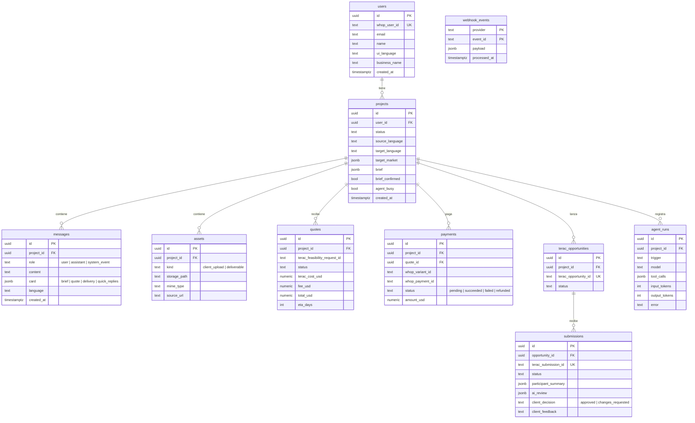

# 07 · Modelo de datos y API

## Diagrama entidad-relación



Notas:
- `participant_summary` guarda solo nombre y experiencia resumida; **no** email ni LinkedIn del profesional.
- `webhook_events` con PK compuesta `(provider, event_id)` garantiza idempotencia.
- RLS de Supabase: `projects.user_id = auth.uid()` (emitir JWT compatible con Supabase o usar un canal Realtime por proyecto autorizado por el backend).

## API propia (`/v1`)

Todas las rutas (salvo auth y webhooks) requieren `Authorization: Bearer <session_jwt>`.

### Autenticación

| Método | Ruta | Descripción |
|--------|------|-------------|
| `POST` | `/v1/auth/whop` | `{ code, code_verifier, redirect_uri }` → `{ session_jwt, user }` |
| `GET` | `/v1/me` | Usuario actual |
| `PATCH` | `/v1/me` | `ui_language`, `business_name` |
| `POST` | `/v1/auth/logout` | Revoca el refresh token de Whop |

### Proyectos y chat

| Método | Ruta | Descripción |
|--------|------|-------------|
| `GET` | `/v1/projects` | Lista con estado y último mensaje |
| `POST` | `/v1/projects` | Crea proyecto en `intake`; el agente envía el saludo |
| `GET` | `/v1/projects/:id` | Proyecto + brief + cotización + entregas |
| `GET` | `/v1/projects/:id/messages?before=` | Historial paginado |
| `POST` | `/v1/projects/:id/messages` | `{ content, asset_ids? }` → `202`; respuesta del agente por Realtime |
| `POST` | `/v1/projects/:id/brief/confirm` | Confirma el brief → el agente pide cotización |

### Archivos

| Método | Ruta | Descripción |
|--------|------|-------------|
| `POST` | `/v1/projects/:id/assets` | `{ filename, mime_type }` → `{ asset_id, upload_url }` |
| `POST` | `/v1/projects/:id/assets/:assetId/complete` | Marca la subida como terminada |
| `GET` | `/v1/projects/:id/assets/:assetId/url` | URL firmada de descarga |

### Cotización y pago

| Método | Ruta | Descripción |
|--------|------|-------------|
| `POST` | `/v1/projects/:id/quote/accept` | Crea el checkout de Whop → `{ purchase_url }`; estado `awaiting_payment` |
| `GET` | `/v1/projects/:id/payment` | Estado del pago (respaldo si Realtime falla) |

### Entregas

| Método | Ruta | Descripción |
|--------|------|-------------|
| `GET` | `/v1/projects/:id/submissions` | Entregas con revisión de la IA |
| `POST` | `/v1/projects/:id/submissions/:sid/decision` | `{ decision: "approve" \| "request_changes", feedback? }` |

### Webhooks y tareas

| Método | Ruta | Descripción |
|--------|------|-------------|
| `POST` | `/webhooks/whop` | Pagos (firma verificada) |
| `POST` | `/webhooks/terac` | Entregas (HMAC `X-Terac-Request-Signature`) |
| `GET` | `/cron/poll-quotes` | Vercel Cron, protegido con `CRON_SECRET` |

## Formato de errores

```json
{ "error": { "code": "INVALID_STATE", "message": "El proyecto debe estar en 'quoted' para aceptar la cotización.", "details": { "status": "intake" } } }
```

Códigos: `UNAUTHORIZED`, `NOT_FOUND`, `INVALID_STATE`, `VALIDATION_ERROR`, `UPSTREAM_TERAC`, `UPSTREAM_WHOP`, `RATE_LIMITED`.

## Paquete compartido (`packages/shared`)

- `ProjectStatus` y la tabla de transiciones válidas (la usan backend y app).
- Esquemas zod: `Brief`, `Quote`, `SubmissionReview`, cuerpos de cada endpoint.
- Utilidades de idioma: validar BCP-47, nombre del idioma con `Intl.DisplayNames`.
